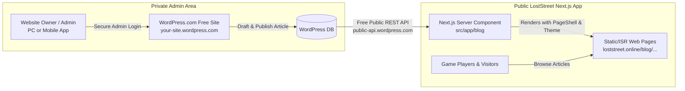

# Headless WordPress Blog Integration Guide (100% Free Setup)

> **Application**: LostStreet ([loststreet.online](https://www.loststreet.online))  
> **Architecture**: Headless WordPress.com (Free Tier) + Next.js 16 (App Router) + React 19  
> **Cost**: **$0.00** (Zero domain costs, zero hosting costs)  
> **Access Control**: Owner/Admin only (Site visitors & game players have zero access to WordPress)

---

## 1. Architectural Overview

Instead of running a bulky WordPress theme or paying for hosting/domains, we decouple content management from content display:



### Why this satisfies all requirements:
1. **$0.00 Cost**: WordPress.com hosts the content and media on their free tier. You do not need to buy an extra domain.
2. **Only YOU can post**: The WordPress dashboard is protected by your personal admin login and 2FA. User registration is disabled so visitors cannot create accounts.
3. **Visitors only read**: Next.js connects via WordPress's read-only public REST API. Visitors only interact with your existing LostStreet website.
4. **Mobile publishing**: You can draft and publish articles directly from the free WordPress mobile app on Android or iOS.

---

## 2. Phase 1: Create Your 100% Free WordPress.com Account

> [!IMPORTANT]
> WordPress.com prompts users with paid domains and plans during onboarding. **Do not pay or enter any credit card**. Follow these exact steps:

1. **Sign Up**:
   - Go to [wordpress.com/start](https://wordpress.com/start).
   - Enter your email, username, and password (or continue with Google).
2. **Choose a Free Subdomain**:
   - When asked to *"Choose a domain"*, type a name like `loststreet-cms` or `placefinder-blog`.
   - Scroll past the paid recommendations (`.com`, `.net`) to the option ending with `.wordpress.com` that displays a green **"Free"** badge.
   - Click **Select**.
3. **Select the Free Plan**:
   - On the plan selection screen (Personal, Premium, Business), locate the link near the top or bottom:  
     👉 **"Start with a free site"** (or **"Pick a free plan"**).
   - Click it. Your free site is created immediately at **$0**.
4. **Lock Down Permissions (Owner Only)**:
   - In your WordPress dashboard, navigate to **Settings $\to$ General**.
   - Under **Privacy**, confirm the site is set to **Public** (required so Next.js can read published articles via API).
   - Under **Membership**, ensure **"Anyone can register" is UNCHECKED**.
   - Enable 2-Factor Authentication (2FA) under your profile security settings.

---

## 3. Phase 2: Authoring Your First Post

1. Navigate to **Posts $\to$ Add New Post**.
2. Add a title (e.g. `Welcome to LostStreet: The World Detective Game`).
3. Add your content using the standard WordPress Gutenberg blocks (headings, paragraphs, bullet points, images).
4. In the right-hand **Post settings** panel:
   - **Featured Image**: Upload your cover banner (this becomes the preview card image).
   - **Excerpt**: Write a concise 1-2 sentence description.
   - **Slug / Permalink**: Verify the URL slug (e.g. `welcome-to-loststreet`).
5. Click **Publish**.

---

## 4. Phase 3: Verify the Public REST API Endpoint

WordPress.com automatically provides a public read-only JSON API for all free sites. Test yours by opening this URL in your browser (substitute your site name):

```
https://public-api.wordpress.com/wp/v2/sites/YOUR_SITE_NAME.wordpress.com/posts?_embed
```

Example:
```
https://public-api.wordpress.com/wp/v2/sites/loststreet-cms.wordpress.com/posts?_embed
```

You should see a JSON array containing your published post, title, excerpt, rendered HTML content, and featured image URL.

---

## 5. Phase 4: Code Implementation in Next.js

### 5.1. Allow WordPress Media in `next.config.mjs`

Add the WordPress CDN hostnames to `remotePatterns` in [next.config.mjs](file:///d:/placefinder/clone/next.config.mjs) so Next.js can optimize images:

```javascript
// next.config.mjs
images: {
  formats: ['image/avif', 'image/webp'],
  minimumCacheTTL: 86400,
  remotePatterns: [
    { protocol: 'https', hostname: 'ui-avatars.com' },
    { protocol: 'https', hostname: 'lh3.googleusercontent.com' },
    // WordPress.com Media CDNs:
    { protocol: 'https', hostname: '**.wp.com' },
    { protocol: 'https', hostname: '**.wordpress.com' },
    { protocol: 'https', hostname: '**.files.wordpress.com' },
  ],
},
```

---

### 5.2. Create WordPress API Client (`src/lib/wordpress.js`)

Create a helper file at `src/lib/wordpress.js` to manage fetching, caching, and formatting:

```javascript
// src/lib/wordpress.js

// Replace with your actual WordPress.com site address
const WP_SITE = 'YOUR_SITE_NAME.wordpress.com';
const WP_API = `https://public-api.wordpress.com/wp/v2/sites/${WP_SITE}`;

/**
 * Fetch all published posts
 */
export async function getAllPosts(page = 1, perPage = 12) {
  try {
    const res = await fetch(`${WP_API}/posts?_embed&per_page=${perPage}&page=${page}`, {
      // Revalidate cache every 10 minutes (Incremental Static Regeneration)
      next: { revalidate: 600 },
    });

    if (!res.ok) return [];
    const posts = await res.json();
    return posts.map(formatPost);
  } catch (error) {
    console.error('Failed to fetch WordPress posts:', error);
    return [];
  }
}

/**
 * Fetch a single post by slug
 */
export async function getPostBySlug(slug) {
  try {
    const res = await fetch(`${WP_API}/posts?slug=${encodeURIComponent(slug)}&_embed`, {
      next: { revalidate: 600 },
    });

    if (!res.ok) return null;
    const posts = await res.json();
    if (!posts || posts.length === 0) return null;

    return formatPost(posts[0]);
  } catch (error) {
    console.error('Failed to fetch post by slug:', error);
    return null;
  }
}

/**
 * Format raw WordPress response into clean props
 */
function formatPost(post) {
  const featuredMedia = post._embedded?.['wp:featuredmedia']?.[0];
  const imageUrl = featuredMedia?.source_url || '/blog-loststreet-logo.png';

  const formattedDate = new Date(post.date).toLocaleDateString('en-US', {
    month: 'long',
    day: 'numeric',
    year: 'numeric',
  });

  const wordCount = post.content?.rendered?.replace(/<[^>]+>/g, '').split(/\s+/).length || 0;
  const readTime = `${Math.max(1, Math.ceil(wordCount / 200))} min read`;

  const cleanExcerpt = post.excerpt?.rendered
    ?.replace(/<[^>]+>/g, '')
    ?.replace(/\[&hellip;\]/g, '...')
    ?.trim() || '';

  return {
    id: post.id,
    slug: post.slug,
    title: post.title.rendered,
    desc: cleanExcerpt,
    content: post.content.rendered,
    date: formattedDate,
    readTime,
    image: imageUrl,
  };
}
```

---

### 5.3. Dynamic Blog Listing Page (`src/app/blog/page.js`)

Update [src/app/blog/page.js](file:///d:/placefinder/clone/src/app/blog/page.js) to dynamically render articles while maintaining the existing editorial design and `PageShell`:

```javascript
// src/app/blog/page.js
import Link from 'next/link';
import { PageShell } from '@/app/components/SiteShell';
import { getAllPosts } from '@/lib/wordpress';

export const metadata = {
  title: 'LostStreet Blog — News, Strategy Guides, and Geography Articles',
  description: 'Read the latest news, updates, and geography articles from the LostStreet editorial team.',
  alternates: { canonical: 'https://www.loststreet.online/blog' },
};

export default async function BlogIndex() {
  const posts = await getAllPosts();

  return (
    <>
      <style>{`
        .blog-card > div {
          transition: transform 0.2s, box-shadow 0.2s, border-color 0.2s !important;
        }
        .blog-card:hover > div {
          transform: translateY(-4px) !important;
          box-shadow: 0 12px 25px rgba(0,0,0,0.06) !important;
          border-color: #10b981 !important;
        }
      `}</style>
      <PageShell breadcrumb="Blog" badgeText="LostStreet Articles" badgeColor="green">
        <main style={{
          background: '#f9fafb',
          minHeight: '100vh',
          fontFamily: '"Inter", system-ui, sans-serif'
        }}>
          <section style={{
            padding: 'clamp(3rem, 6vw, 5rem) clamp(1rem, 3vw, 2.5rem)',
            maxWidth: '1200px',
            margin: '0 auto',
            textAlign: 'center'
          }}>
            <h1 style={{
              fontSize: 'clamp(2.5rem, 5vw, 3.8rem)',
              fontWeight: 900,
              color: '#111827',
              marginBottom: '1rem',
              fontFamily: '"Outfit", sans-serif',
              letterSpacing: '-0.02em'
            }}>
              The LostStreet <span style={{ color: '#10b981' }}>Blog</span>
            </h1>
            <p style={{
              fontSize: 'clamp(1.1rem, 2vw, 1.25rem)',
              color: '#4b5563',
              maxWidth: '650px',
              margin: '0 auto',
              lineHeight: 1.6
            }}>
              News, game updates, and feature articles about geography exploration.
            </p>
          </section>

          <section style={{ maxWidth: '1200px', margin: '0 auto', padding: '0 clamp(1rem, 3vw, 2.5rem) 4rem' }}>
            {posts.length === 0 ? (
              <p style={{ textAlign: 'center', color: '#6b7280', padding: '3rem 0' }}>
                No articles published yet. Check back soon!
              </p>
            ) : (
              <div style={{ display: 'grid', gridTemplateColumns: 'repeat(auto-fill, minmax(320px, 1fr))', gap: '2rem' }}>
                {posts.map((post) => (
                  <Link 
                    key={post.slug} 
                    href={`/blog/${post.slug}`}
                    style={{ textDecoration: 'none' }}
                    className="blog-card"
                  >
                    <div style={{
                      background: '#ffffff',
                      borderRadius: '16px',
                      border: '1px solid #e5e7eb',
                      boxShadow: '0 4px 15px rgba(0,0,0,0.03)',
                      height: '100%',
                      display: 'flex',
                      flexDirection: 'column',
                      overflow: 'hidden'
                    }}>
                      <div style={{
                        width: '100%',
                        height: '200px',
                        backgroundImage: `url(${post.image})`,
                        backgroundSize: 'cover',
                        backgroundPosition: 'center',
                        borderBottom: '1px solid #f3f4f6',
                        backgroundColor: '#fafafa'
                      }} />
                      <div style={{ padding: '1.5rem', display: 'flex', flexDirection: 'column', flexGrow: 1 }}>
                        <h2 
                          style={{ fontSize: '1.25rem', fontWeight: 800, color: '#111827', marginBottom: '0.75rem', lineHeight: 1.4 }}
                          dangerouslySetInnerHTML={{ __html: post.title }}
                        />
                        <p style={{ color: '#4b5563', fontSize: '0.95rem', lineHeight: 1.6, marginBottom: '1.5rem', flexGrow: 1 }}>
                          {post.desc}
                        </p>
                        <div style={{ display: 'flex', alignItems: 'center', justifyContent: 'space-between', color: '#6b7280', fontSize: '0.85rem', fontWeight: 500, paddingTop: '1rem', borderTop: '1px solid #f3f4f6' }}>
                          <span>{post.date}</span>
                          <span>{post.readTime}</span>
                        </div>
                      </div>
                    </div>
                  </Link>
                ))}
              </div>
            )}
          </section>
        </main>
      </PageShell>
    </>
  );
}
```

---

### 5.4. Dynamic Article Page (`src/app/blog/[slug]/page.js`)

Create a single dynamic route `src/app/blog/[slug]/page.js` to render every published article:

```javascript
// src/app/blog/[slug]/page.js
import { notFound } from 'next/navigation';
import { PageShell } from '@/app/components/SiteShell';
import { getPostBySlug } from '@/lib/wordpress';

export async function generateMetadata({ params }) {
  const { slug } = await params;
  const post = await getPostBySlug(slug);
  if (!post) return { title: 'Article Not Found — LostStreet' };

  return {
    title: `${post.title} — LostStreet Blog`,
    description: post.desc,
    alternates: { canonical: `https://www.loststreet.online/blog/${slug}` },
    openGraph: {
      title: post.title,
      description: post.desc,
      url: `https://www.loststreet.online/blog/${slug}`,
      type: 'article',
      images: [{ url: post.image }],
    },
    twitter: {
      card: 'summary_large_image',
      title: post.title,
      description: post.desc,
      images: [post.image],
    },
  };
}

export default async function BlogPostPage({ params }) {
  const { slug } = await params;
  const post = await getPostBySlug(slug);

  if (!post) notFound();

  return (
    <PageShell breadcrumb={post.title} badgeText="Article" badgeColor="green">
      <main style={{
        background: '#ffffff',
        minHeight: '100vh',
        padding: 'clamp(2rem, 5vw, 4rem) 1rem',
        fontFamily: '"Inter", system-ui, sans-serif'
      }}>
        <article style={{ maxWidth: '820px', margin: '0 auto' }}>
          {/* Header */}
          <div style={{ marginBottom: '2.5rem', borderBottom: '1px solid #f3f4f6', paddingBottom: '2rem' }}>
            <h1 
              style={{
                fontSize: 'clamp(2rem, 4vw, 3rem)',
                fontWeight: 900,
                color: '#111827',
                lineHeight: 1.25,
                marginBottom: '1rem',
                fontFamily: '"Outfit", sans-serif'
              }}
              dangerouslySetInnerHTML={{ __html: post.title }}
            />
            <div style={{ display: 'flex', gap: '1rem', color: '#6b7280', fontSize: '0.9rem' }}>
              <span>Published on {post.date}</span>
              <span>•</span>
              <span>{post.readTime}</span>
            </div>
          </div>

          {/* Featured Image */}
          {post.image && (
            <div style={{
              width: '100%',
              maxHeight: '440px',
              borderRadius: '16px',
              overflow: 'hidden',
              marginBottom: '3rem',
              border: '1px solid #e5e7eb'
            }}>
              
            </div>
          )}

          {/* WordPress HTML Content */}
          <div 
            style={{
              fontSize: '1.1rem',
              lineHeight: 1.8,
              color: '#374151',
            }}
            dangerouslySetInnerHTML={{ __html: post.content }}
          />
        </article>
      </main>
    </PageShell>
  );
}
```

---

## 6. Daily Publishing Workflow (Summary)

```
1. Open wordpress.com (or the WordPress Mobile App on iOS/Android).
2. Write article, add images, and set a featured image.
3. Click "Publish".
4. The article automatically displays on https://www.loststreet.online/blog within minutes.
```
- **No Git commits needed** for each article.
- **No server deployments needed**.
- **No cost incurred**.
